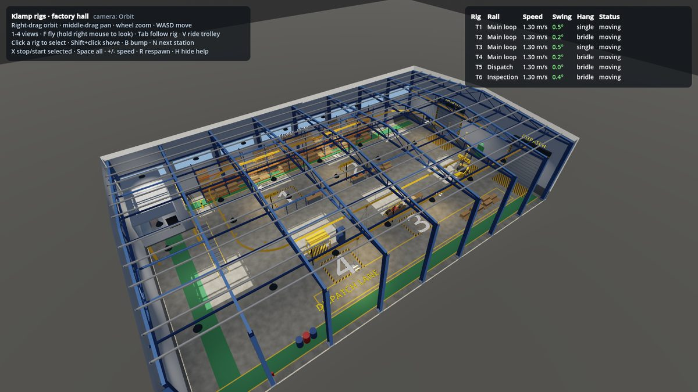
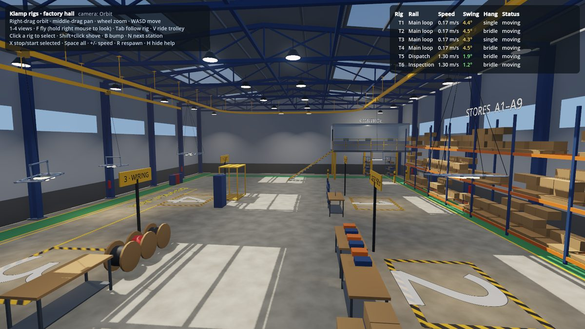
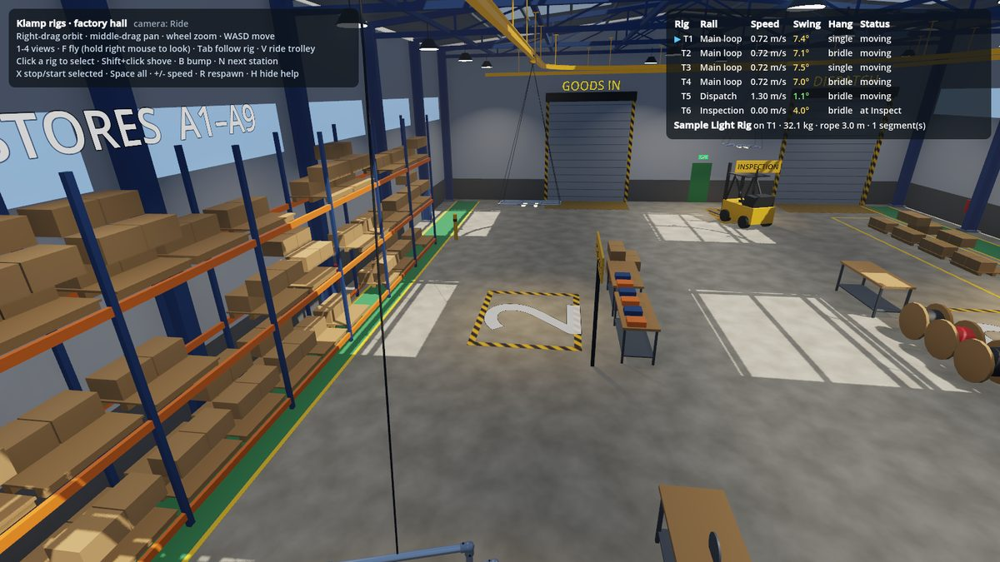

# Klamp Studio → Godot: hanging rigs on ceiling rails

This folder is a Godot 4 project with two parts:

- **`addons/klamp_lamp/`** is a small script library you copy into your own game. It turns a Klamp Studio export into a physics body, hangs it on a rope, and runs it along overhead rails on trolleys.
- **`demo/`** is a facility with a looped rail and a shuttle rail. Four rigs ride on trolleys, stop at stations and swing as they go.

It needs **Godot 4.4 or later**, because the project uses the built-in Jolt physics engine.

## Try the demo



1. Open `godot/project.godot` in Godot. The editor imports the two sample `.glb` files the first time.
2. Press **F5**.

The demo is a 40 × 24 m steel-framed factory hall. It has:

- roof trusses, with skylights that let in shafts of sunlight
- high-bay lights
- pallet racking along one wall
- a control office on a mezzanine
- a forklift, and roller doors at the goods-in and dispatch end

Six rigs (two sample designs exported from Klamp Studio) ride on three yellow overhead rails:

- **Main loop:** four trolleys stop in turn at four work stations: *Cut & prep*, *Assembly*, *Wiring* and *Test*.
- **Dispatch shuttle:** runs along the dispatch lane out to the roller door.
- **Inspection spur:** runs across the goods-in end.

The rigs are hung four different ways: a taut single cable, a 4-segment rope, a 2-cable sling, and a 4-cable sling.

The walls and roof are one-sided. From outside you look straight in (a "dollhouse" view), and from inside the building is closed.

| Camera | |
|---|---|
| Right-drag | Orbit |
| Middle-drag or Shift + right-drag | Pan |
| Wheel | Zoom |
| W A S D | Move |
| `1` – `4` | Overview, floor level, west end, a work station |
| F | Fly mode: hold the right mouse button to look, W A S D / Q E to move, Shift to go faster |
| Tab | Follow the next rig |
| V | Ride on the selected trolley, looking down at its rig |

| Rigs | |
|---|---|
| Click | Select a rig (a ring marks it on the floor) |
| Shift + click | Shove it |
| B | Bump the selected rig |
| N | Send its trolley to the next station |
| X | Stop or start the selected trolley |
| Space | Stop or start all trolleys |
| `+` / `-` | Speed up or slow down |
| R | Respawn the rigs |
| H | Hide the help |

The panel on the right shows each trolley's speed and status, and how far its rig is swinging (green under 3°, amber under 8°, red above).

The hall is built in code by `demo/factory_hall.gd`. Use it as a starting point, or replace it with your own level: the rails, trolleys and hangers don't depend on it.

| Floor level | Riding a trolley |
|---|---|
|  |  |

## Use your own design

1. In Klamp Studio open **⋯ → Export for Godot (.glb)**.
   - **Balance point** hangs the structure from a point on top, straight above its centre of mass, so it hangs level.
   - **Selected joint** hangs it from the joint you tapped before opening the menu. An off-centre joint hangs tilted, as it would in real life.
2. Copy `addons/klamp_lamp` into your project's `addons/` folder. There is no plugin to enable, because the classes register themselves.
3. Drop the `.glb` into your project.
4. Build this scene tree:

```
Facility (Node3D)
└─ CeilingRail (Path3D)        draw the rail with the path tool, at beam height
   └─ RailTrolley              progress, cruise_speed, stops, dwell_time …
      └─ KlampHanger           lamp_scene = your .glb, rope_length, hang_mode
```

Press Play. The rig and its rope are created when the scene starts. In the editor, `KlampHanger` shows a preview of where the rig will hang.

### Rails

- Draw the `CeilingRail` path along the beam's centre line.
- **Round the corners with curve handles.** A sharp corner swings the trolley round instantly and jerks the load.
- **Loops:** put the last point exactly on the first, and trolleys go round and round.
- **Open rails:** trolleys shuttle back and forth between the ends.
- **Hangers:** the beam is an I-section built with CSG. `hanger_spacing` and `hanger_length` add drop rods up to the ceiling.

### Trolleys (`RailTrolley`, an `AnimatableBody3D`)

| Property / method | What it does |
|---|---|
| `progress` | Position along the rail in metres. Set it in the Inspector to place the trolley. |
| `cruise_speed`, `acceleration`, `braking` | Motion profile. Gentle braking means less swing. |
| `running` | Set to false to brake to a stop and wait. |
| `stops`, `dwell_time` | Distances to stop at, and how long to wait at each. |
| `min_gap` | Keeps a trolley this far behind the next trolley on the same rail. |
| `move_to(distance)` | Sends the trolley to one place. It emits `arrived(-1)` when it gets there. |
| `cancel_move()` | Drops a `move_to()` target. |
| `arrived(stop_index)`, `departed(stop_index)` | Signals for your game logic. |

If the trolley has no mesh of its own, it builds a simple yellow carriage. Its origin is the lifting eye, so put the `KlampHanger` at the origin.

### Hangers (`KlampHanger`, a `Marker3D`)

| Property / method | What it does |
|---|---|
| `rope_length` | Vertical drop from the hanger to the rig's hang point. |
| `hang_mode` | `SINGLE`: one rope to the hang point. `BRIDLE`: one rope to each top corner, like a sling. |
| `lamp_yaw` | Turns the rig relative to the direction of travel. |
| `rope_segments` | `1` is a taut cable and the most stable. More segments let the rope bend and whip. |
| `rope_mass_ratio` | Rope weight as a fraction of the rig's. See the tuning notes. |
| `extra_mass` | Weight of light fittings, cable trays and anything else that isn't in the pipe model. |
| `lamp_collision_layer` / `_mask` | The rig collides with your level. Ropes don't collide by default. |
| `lamp_linear_damp`, `lamp_angular_damp` | Air resistance. Higher values make swinging die down faster. |
| `lamp` | The rig's `RigidBody3D`, once it has spawned. |
| `get_swing_angle()` | Radians from vertical. Useful for scoring smooth driving or for safety limits. |
| `push(impulse, at)` | Bump the rig, for example from a forklift or the player. |
| `spawn()`, `despawn()`, signal `spawned(lamp)` | Respawn the rig, or attach lights and props to it once it exists. |

If there is no physics body above it in the tree, a `KlampHanger` hangs from a fixed point.

### Using a rig without a rope

`KlampLampBuilder.build(scene.instantiate())` returns a `RigidBody3D` you can use anywhere, for example on a crane hook or a pallet. Its metadata `klamp` holds:

- `mass_kg`
- `hang_point`
- `center_of_mass`
- `attach_points`
- `bounds`

To make the import itself produce a ready-made rigid body:

1. Select the `.glb`.
2. In the **Import** dock, set **Import Script** to `addons/klamp_lamp/klamp_post_import.gd`.
3. Click **Reimport**.

## What's in the exported .glb

The export is glTF binary, in metres, with Y up. **The origin is the hang point.**

| Node | Meaning |
|---|---|
| `Structure` | The pipes and fittings merged into one mesh. Its surfaces use the materials `Steel_Pipe`, `Fitting_Iron`, `Set_Screw`, `Swivel_Brass` and `Plug`. |
| `HangPoint` | Where the single rope attaches. |
| `CenterOfMass` | Worked out from pipe lengths (galvanised tube weight per metre) and fitting weights. |
| `Attach_1` … `Attach_n` | The outermost top joints, used as sling points in `BRIDLE` mode. |
| `Collision/CYL_*` | A cylinder per pipe and flange. The node's scale is (radius, height, radius). |
| `Collision/SPH_*` | A sphere per fitting. The node's scale is the radius. |
| glTF extras `klamp` | Weight in kg, centre of mass, pipe size, attach points, bounds and the design name. Godot 4.3+ imports these as metadata `extras`. |

The weights are estimates: EN 10255 medium tube, plus a typical malleable-iron fitting. If Godot doesn't import the extras, the builder estimates the weight from the collision shapes.

## Physics tuning

- **Trolleys teleport, then move.** A `RailTrolley` is an `AnimatableBody3D`. When you set its `progress` from a script outside the physics step, it jumps straight there. During the physics step it moves smoothly. `KlampHanger` waits until the physics engine has caught up with the trolley before it joints a rope to it. If you build your own joints to a trolley, do the same, or the first step will yank them across the level.

- The project runs physics at **120 Hz with Jolt**. Swinging loads on joint chains are much steadier that way than at 60 Hz with Godot Physics.
- **Heavy rig, light rope:** a chain of very light bodies holding a heavy one stretches and jitters. Keep `rope_mass_ratio` between 0.05 and 0.2, or use fewer segments. A taut steel cable under load is close to straight anyway, so `rope_segments = 1` is realistic.
- **Gentle braking:** a trolley that brakes or turns sharply swings its rig harder, as it would in real life. Use the `braking` property and rounded corners to control this.
- **Head-on shuttles:** two trolleys shuttling toward each other on one open rail will both stop at `min_gap` and stay stuck. Give each its own rail or its own section of `stops`.
